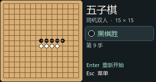
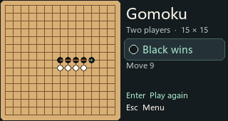
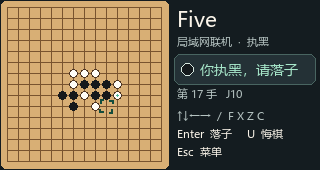
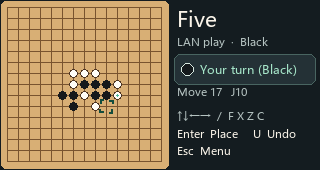
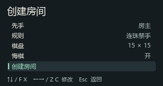
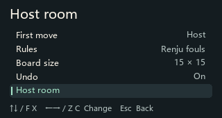
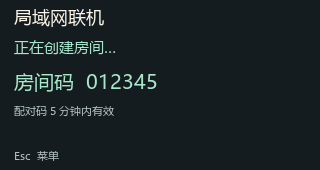
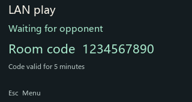

# Five

适配 Cardputer Zero 的五子棋。支持离线人机、同机双人和局域网双人。人机模式可选执黑或执白，难度默认普通。

## 安装

将 `dist/five_1.2.1-2_arm64.deb` 复制到 Cardputer Zero，在设备上运行：

```sh
sudo apt install ./five_1.2.1-2_arm64.deb
```

安装后从应用启动器打开 **Five**。

## 局域网联机 / LAN play

Zero 和 [Five 网页版](https://fivezero.vercel.app) 使用同一套流程。Zero 的入口在「局域网联机」菜单内，网页直接显示两个按钮。

1. 房主选「创建房间」，设置先手、规则、棋盘和悔棋，确认后把自动生成的 10 位房间码发给对手。
2. 对手选「加入房间」，输入这 10 位房间码。任何一方都可以用 Zero 或网页。

双方应接入同一局域网。创建和加入时需要联网交换配对信息，落子通过 WebRTC 在双方之间直连。目前仅支持局域网对战。房间码 5 分钟内有效，对局时保持应用或网页打开。开启悔棋后，轮到自己时按 `U` 或点击「悔棋」回到自己上一手之前。

On a Zero or the [Five web app](https://fivezero.vercel.app), choose **Create room**, set the match options, and share the generated 10-digit code. The other player chooses **Join room** and enters the code. Either device can host or join. Both players should be on the same LAN. Internet access is required for pairing, and moves travel directly between players over WebRTC. The code is valid for five minutes. Keep Five or the browser tab open during the game.

## 商店简介

五子棋，支持 Rapfi、同机双人和房间码联机。 Gomoku with Rapfi, local and LAN play.

**简体中文**

在 Cardputer Zero 上下五子棋。可与 Rapfi 对弈，选择三档难度，也可在同一台设备轮流落子。联机时，Zero 和浏览器都可创建房间，用 10 位房间码加入。同一局域网内可双 Zero、双网页或混合对战，电脑无需安装或运行额外程序。支持 15×15 和 13×13 棋盘、自由规则与连珠禁手，界面提供简体中文和英文。联机配对需要互联网连接，对局在局域网内直连。网页版：https://fivezero.vercel.app/

**English**

Play Gomoku against Rapfi at three difficulty levels, take turns on one Cardputer Zero, or play over your LAN. Either a Zero or a browser can host or join using a 10-digit room code. The browser needs no extra software. Choose a 15×15 or 13×13 board with Freestyle or Renju fouls. The interface supports Simplified Chinese and English. Pairing requires internet access. Moves travel directly between players on the LAN. Web app: https://fivezero.vercel.app/

## 截图 / Screenshots

| 简体中文 | English |
| --- | --- |
|  |  |
|  |  |
|  |  |
|  |  |

## 最近改动 / What's new

**1.2.1-2**

- 主菜单和对局标题随界面语言显示「五子棋」或「Gomoku」。商店应用名仍为 Five。
- The main menu and game titles follow the interface language, showing 五子棋 in Chinese and Gomoku in English. The store name remains Five.

**1.2.1-1**

- 菜单操作加入音效，统一由「音效」开关控制。连珠禁手模式可实时标出禁手点（默认关闭），也可选择禁止落子（默认）或黑棋直接判负。
- A single sound setting controls menu and move effects. Renju can mark forbidden points on Black's turn (off by default) and can either block a forbidden move (default) or count it as an immediate loss for Black.

**1.2.0-3**

- 对局结束后显示「重新开始」。离线对局保留当前设置，联机对局在双方确认后于原房间重新开始。
- The results screen now offers **Play again**. Offline games keep the current settings. In LAN play, both players confirm to start another game in the same room.

**1.2.0-2**

- 新增局域网联机。Zero 和网页统一用 10 位房间码创建或加入房间，无需填写 IP。房主可设置先手、规则、棋盘尺寸和联机悔棋。光标越过棋盘边缘时会从对侧出现，应用图标与首页棋子布局一致。
- Added LAN play between Zero devices and browsers using a shared 10-digit room code workflow. The host can set who moves first, rules, board size, and undo. The cursor wraps around board edges, and the app icon matches the board on the home screen.

**1.2.0-1**

- 网页可直接创建房间，同一局域网的浏览器或新版 Zero 可用 10 位房间码加入。
- Create a room directly in the browser. A second browser or an updated Zero on the LAN can join with a 10-digit code.

**1.1.0-4**

- Windows 版创建房间工具内置运行环境，界面和说明统一使用「创建房间」。
- The portable Windows hosting tool includes its runtime. Chinese room creation labels are consistent across the app and web.

**1.1.0-3**

- 网页可自动发现本机创建房间工具，识别局域网地址并生成房间码；有多个地址时可选择。
- The web app can find the local hosting tool, detect LAN addresses, and generate a room code. Choose an address if several are available.

**1.1.0-2**

- 新增网页创建房间、先手和规则设置、可选联机悔棋及联机说明。图标棋子布局与首页棋盘一致。
- Added browser hosting, first-player and rule selection, optional LAN undo, and a LAN guide. The icon now uses the home-screen board position.

**1.1.0-1**

- 新增局域网联机。Zero 和浏览器可自由组合，支持自动重连。
- 光标越过棋盘边缘时会从对侧出现。
- Added LAN play between Zero devices and browsers, with automatic reconnection.
- The cursor wraps around the edges of the board.

**1.0.0-7**

- Rapfi 落子失败后会自动重试。连续失败时，重试间隔从 0.5 秒逐步增加到 4 秒。重试期间仍可悔棋或返回菜单。
- Five automatically retries when Rapfi fails to return a move. For repeated failures, the delay grows from 0.5 seconds to 4 seconds. You can still undo or return to the menu while Five retries.

## 按键

| 按键 | 操作 |
| --- | --- |
| 方向键或 F / X / Z / C | 上 / 下 / 左 / 右移动光标，跨过边缘时从对侧出现 |
| Enter | 落子、确认菜单选项，或在终局后重新开始 |
| U | 悔棋。人机模式回到玩家上次落子前，双人模式退一步 |
| Esc 短按 | 松开时返回主菜单 |
| Esc 长按 3 秒 | 从任意页面退出应用 |

应用自动保存最近一局未完成的对局。新开一局前会确认是否替换存档。
电脑思考时可移动光标，电脑落子后光标留在原处。棋子上的标记指示最近一手。

## 设置

- 棋盘默认 15×15，可改为 13×13。棋盘和规则设置在新局生效。
- 人机执棋颜色在新局生效。选执白时由电脑执黑先手，悔棋最早可退到电脑的第一手之后。
- 简单、普通、困难使用 Rapfi 的棋力参数 25、65、100，并分别限制搜索时间和深度。
- 默认自由规则，黑白都无禁手，五连及以上获胜。
- 连珠禁手中，黑棋恰好五连获胜，白棋五连或更长即胜。黑棋三三、四四或长连是禁手，同一步恰好五连时优先判黑胜。可以在设置中显示禁手点。离线对局由设置决定如何处理禁手，联机对局由房主决定。
- 旧版仅启用部分禁手的人机棋局可以按原规则以同机双人方式续下。
- 界面支持简体中文和英文，默认简体中文。
- 落子音效默认开启，可在设置中关闭。人机和双人对局共用这一设置。

## 桌面预览与打包

使用 Python 3.9+ 和 Pillow 9.2+。桌面预览还需要 Tk。Linux 可安装 `fonts-noto-cjk`。可用 `FIVE_FONT` 指定字体文件。

```sh
python -m pip install "Pillow>=9.2" aiortc
python five.py
pwsh -File build_rapfi.ps1
python build_package.py
```

Zero 联机依赖 Debian 的 `python3-aiortc` 和系统 CA 证书，使用 `apt` 安装 Five 时会解析这些依赖。

## 代码来源与许可证

Windows 上的 ARM64 打包使用 `build_rapfi.ps1`。桌面预览的人机模式可通过 `FIVE_RAPFI` 指定适合本机的 Rapfi 可执行文件，模型和配置放在该文件旁。

Five 用标准 Gomocup 文本协议与独立的 Rapfi 进程通信。Rapfi 引擎按 GPL-3.0-or-later 分发，官方经典模型权重采用 CC0-1.0。安装包的 `/usr/share/doc/five/` 包含许可证文本、精确对应的 Rapfi 源码和构建脚本。引擎提交为 `1387d11312190ec66665d361ff07a7c70221b78a`，权重提交为 `7eeb19b55219a48138756293f92211a1539bab4d`。

Five 自有代码与项目资源采用 **GPL-3.0-or-later**，全文见 [LICENSE](LICENSE)。屏幕适配代码和 Debian 打包脚本沿用了 WebRadio 的部分实现。Pillow、python-evdev 和 Noto CJK 字体通过系统软件包安装。

Five's own source and assets are licensed under **GPL-3.0-or-later**. The bundled Rapfi executable is licensed under GPL-3.0-or-later, and its model weights are licensed under CC0-1.0. The package includes Rapfi's corresponding source and build script.

- [Rapfi 引擎许可证](https://github.com/dotb1ue/rapfi/blob/master/Copying.txt)
- [Rapfi 官方权重](https://github.com/dotb1ue/rapfi-networks)
- [GPLv3 第 6 节](https://www.gnu.org/licenses/gpl-3.0.html#section6)
